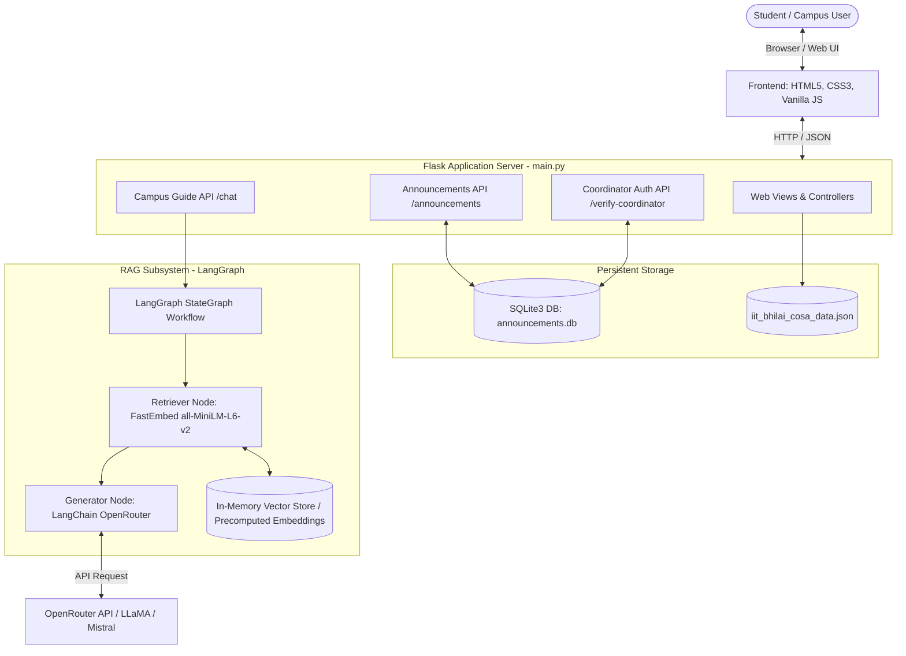
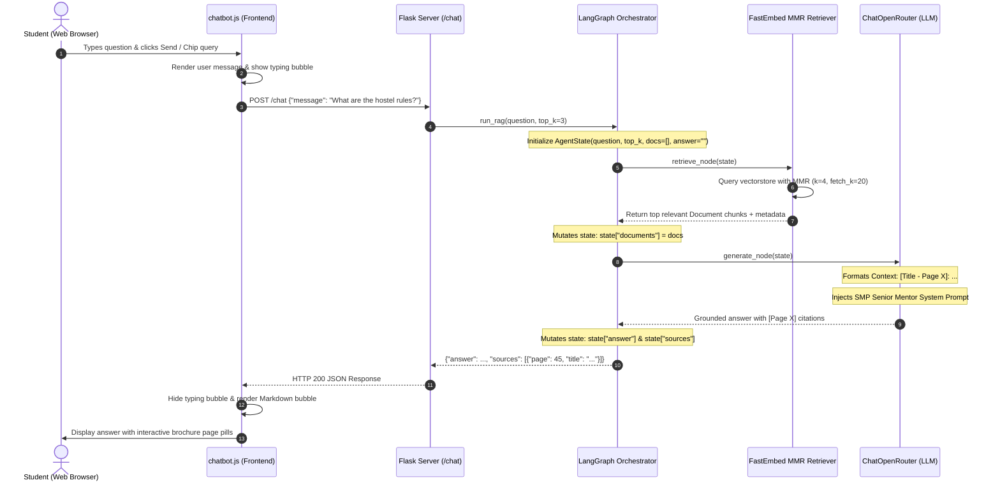

# 🏛️ Cluvora — IIT Bhilai CoSA Campus Engagement & AI Portal

> **The Centralized Student Life, Club Discovery, Real-Time Announcements & AI Handbook Ecosystem for IIT Bhilai (Council of Student Affairs — CoSA).**

<p align="center">
  
  
  
  
  
  
  
  
  
  
</p>

---

## 📌 Table of Contents

- [About The Project](#-about-the-project)
- [Key Features & Capabilities](#-key-features--capabilities)
- [System Architecture](#-system-architecture)
  - [High-Level Flow Diagram](#high-level-flow-diagram)
  - [Core Subsystem Architecture](#core-subsystem-architecture)
- [RAG Bot Architecture & Pipeline](#-rag-bot-architecture--pipeline)
  - [LangGraph StateGraph Workflow](#langgraph-stategraph-workflow)
  - [Lifecycle Sequence Diagram](#lifecycle-sequence-diagram)
  - [Subsystem Component Breakdown](#subsystem-component-breakdown)
- [Tech Stack](#-tech-stack)
- [Project Directory Structure](#-project-directory-structure)
- [Prerequisites](#-prerequisites)
- [How to Run the Project (Step-by-Step)](#-how-to-run-the-project-step-by-step)
  - [1. Clone the Repository](#1-clone-the-repository)
  - [2. Create and Activate Virtual Environment](#2-create-and-activate-virtual-environment)
  - [3. Install Required Dependencies](#3-install-required-dependencies)
  - [4. Configure Environment Variables](#4-configure-environment-variables)
  - [5. Run the Application](#5-run-the-application)
  - [6. Explore the Web Portal](#6-explore-the-web-portal)
- [API Endpoints Reference](#-api-endpoints-reference)
- [Troubleshooting & FAQs](#-troubleshooting--faqs)
- [Contributors & Credits](#-contributors--credits)
- [License](#-license)

---

## 📖 About The Project

**Cluvora** is an all-in-one web portal and campus AI guide created for the student community and the **Council of Student Affairs (CoSA)** at the **Indian Institute of Technology Bhilai (IIT Bhilai)**.

Navigating diverse technical clubs, cultural societies, sports bodies, fest committees, and scattered institutional notices across campus can be challenging for freshers, students, and faculty. Cluvora unifies campus life into a cohesive, responsive web platform:

1. **Club & Council Discovery Engine**: Explore 34+ technical, cultural, sports, and welfare bodies with member rosters, faculty advisors, meeting locations, and social connections.
2. **Centralized Broadcast Bulletin**: A live, searchable noticeboard for hackathons, workshops, fest auditions, sports fixtures, and official announcements.
3. **Coordinator Passcode Authentication**: A secure verification mechanism allowing verified student coordinators to post and manage notices with full accountability.
4. **Intelligent Handbook AI Assistant**: A Retrieval-Augmented Generation (RAG) assistant powered by LangGraph, FastEmbed, and OpenRouter that answers questions directly grounded in official IIT Bhilai student brochures and guidelines.
5. **Interactive Campus Guide & Contacts**: Comprehensive directory of CoSA student secretaries, conveners, emergency services, and campus coordinates.

---

## ✨ Key Features & Capabilities

- 🏢 **Centralized Council & Club Discovery**:
  - Structured categorization across **Sci-Tech Council**, **Cultural Council**, **Sports Council**, **Student Welfare & Governance**, and **Media & Publication Body**.
  - Interactive profile dialogs using the native HTML5 `<dialog>` API with deep-linking support (`#club-id`), social links, and leadership PORs.
  - Progressive enhancement search allowing instantaneous fuzzy matching across active club grids without page reloads.

- 📢 **Live Campus Announcements & Broadcast Feed**:
  - Persistent announcement feed powered by **SQLite** (`announcements.db`) with category filter pills (`Sci-Tech`, `Cultural`, `Sports`, `Fest`, `General`).
  - High-priority pinned notice banner highlighting critical recruitment calls and tournament dates.
  - Dynamic full-text search with human-friendly relative timestamps (`Just now`, `3h ago`, `Yesterday`).

- 🛡️ **Coordinator Passcode Authentication**:
  - Secure verification blueprint (`auth.py`) granting posting permissions only to verified club leads and society heads.
  - Live client-side validation flow with instant error feedback, password visibility toggle, and automatic category pre-filling.
  - Role attribution (e.g. `Coordinator`, `Core Team`, `Member`) and authorized deletion privileges for outdated circulars.

- 🤖 **LangGraph RAG Campus Handbook Assistant**:
  - Two-node state graph workflow (`START -> retrieve -> generate -> END`) compiled with **LangGraph**.
  - Semantic vector search using **FastEmbed** (`sentence-transformers/all-MiniLM-L6-v2`) and **Maximal Marginal Relevance (MMR)** retrieval.
  - Natural student-mentor persona citing official brochure page references (`[Page 45]`, `[Page 62]`) with strict factual grounding.

- 🌓 **Adaptive Theming & Pure Glassmorphism Aesthetics**:
  - Complete **Dark / Light mode** toggle with `prefers-color-scheme` detection and local storage persistence.
  - Built with zero heavyweight client frameworks — pure HTML5, responsive CSS3 custom properties, and modern vanilla JavaScript.

---

## 🏗️ System Architecture

### High-Level Flow Diagram



### Core Subsystem Architecture

```text
┌────────────────────────────────────────────────────────────────────────┐
│                        Client Web Interface                            │
│  - Vanilla JavaScript Modules (announcements.js, coordinator_auth.js)  │
│  - HTML5 <dialog> Modals & Deep Link Routing (club_modal.js)           │
│  - Theme Toggle Engine (Dark/Light LocalStorage Sync)                  │
└───────────────────────────────────┬────────────────────────────────────┘
                                    │ HTTP Requests / JSON APIs
                                    ▼
┌────────────────────────────────────────────────────────────────────────┐
│                         Flask Application Core                         │
│  - main.py: Route Controllers, Template Renderer & Database Connectors │
│  - auth.py: Coordinator Authentication Blueprint                       │
└───────────────────┬────────────────────────────────┬───────────────────┘
                    │                                │
                    ▼                                ▼
┌──────────────────────────────────────┐   ┌─────────────────────────────┐
│       SQLite Persistence Layer       │   │   LangGraph RAG Subsystem   │
│  - announcements.db                  │   │   - retriever.py (FastEmbed)│
│    ├── announcements table           │   │   - generator.py (LLM)      │
│    └── coordinator_passcodes table   │   │   - state.py & graph.py     │
└──────────────────────────────────────┘   └─────────────────────────────┘
```

---

## 🤖 RAG Bot Architecture & Pipeline

Cluvora features a custom **Retrieval-Augmented Generation (RAG)** assistant powered by **LangGraph**, **FastEmbed**, and **LangChain OpenRouter**. It is designed to act as a **Student Mentorship Program (SMP) Senior Guide**, answering fresher and student questions grounded directly in the official IIT Bhilai brochure and handbook excerpts.

### LangGraph StateGraph Workflow

The conversational engine uses a compiled **LangGraph `StateGraph`** with explicit state mutation, separating semantic retrieval from language model generation:

```text
               ┌───────────────────────┐
               │         START         │
               └───────────┬───────────┘
                           │
                           ▼
               ┌───────────────────────┐
               │    retrieve_node      │  ◄── FastEmbed (all-MiniLM-L6-v2)
               │ (MMR Vector Search)   │  ◄── InMemoryVectorStore (Precomputed)
               └───────────┬───────────┘
                           │ state['documents'] populated
                           ▼
               ┌───────────────────────┐
               │     generate_node     │  ◄── SMP Senior Guide System Prompt
               │  (ChatOpenRouter LLM) │  ◄── Strict Grounding & Citations
               └───────────┬───────────┘
                           │ state['answer'] & state['sources']
                           ▼
               ┌───────────────────────┐
               │          END          │
               └───────────────────────┘
```

### Lifecycle Sequence Diagram



### Subsystem Component Breakdown

1. **State Definition (`rag/state.py`)**:
   The engine uses a typed state dictionary defining each node's input and output boundaries:
   ```python
   class AgentState(TypedDict, total=False):
       question: str                  # Student inquiry
       top_k: int                     # Number of documents to retain
       documents: List[Document]      # Context passages retrieved from vector store
       answer: str                    # Final synthesized answer
       sources: List[Dict[str, Any]]  # Metadata list (page numbers, section titles)
       system_prompt: str             # Persona guidelines
   ```

2. **Vector Retrieval & FastEmbed MMR (`rag/retriever.py`)**:
   * **FastEmbed Embedding Adapter**: Uses `sentence-transformers/all-MiniLM-L6-v2` running locally via ONNX runtime for ultra-fast, zero-cloud embedding computation.
   * **Precomputed Embedding Cache**: Loads directly from `knowledge.json` and `embeddings.json` in `rag/data_files/`, ensuring zero cold-start delay on server launch (with automatic fallback to `loader.py` brochure PDF parsing).
   * **Maximal Marginal Relevance (MMR)**: Search parameters `search_type="mmr"`, `k=4`, and `fetch_k=20` diversify retrieved context chunks, preventing duplicate sentences from overwhelming the prompt context window.

3. **SMP Senior Mentor System Prompt (`rag/state.py` & `rag/generator.py`)**:
   * **Authentic Peer Voice**: Speaks like a knowledgeable senior guide rather than a robotic assistant (explicitly avoiding clichés like *"As an AI..."* or *"I would be delighted to assist"*).
   * **No Formatting Slop**: Uses natural, fluent sentences and avoids aggressive bolding or unnecessary nested bullet points.
   * **Strict Grounding & Citation**: Facts must strictly originate from handbook excerpts with inline brackets (e.g. `[Page 65]`). If information is absent, it transparently directs the student to CoSA or official portals (`polaris.iitbhilai.ac.in`).

4. **Client-Side Progressive Rendering (`static/js/chatbot.js`)**:
   * Lightweight custom Markdown parser for code snippets (`` `code` ``), bold (`**text**`), italic (`*text*`), and bullet lists (`- item`).
   * Visual reference pills showing exact handbook page numbers with hover titles.
   * Pre-configured quick query chips (`Meraz fest`, `Tech clubs`, `Hostel rules`, `Sports facilities`) for one-click exploration.

---

## 💻 Tech Stack

| Domain | Technology / Library | Description |
| :--- | :--- | :--- |
| **Backend Framework** | [Flask 3.x](https://flask.palletsprojects.com/) | Lightweight WSGI web application framework and routing engine |
| **Language** | [Python 3.10+](https://www.python.org/) | Core backend runtime (tested up to Python 3.14) |
| **Database** | [SQLite3](https://www.sqlite.org/) | Serverless transactional database (`announcements.db`) |
| **AI Orchestration** | [LangGraph](https://langchain-ai.github.io/langgraph/) & [LangChain Core](https://python.langchain.com/) | Cyclic state graph workflow execution for RAG retrieval and generation |
| **Vector Embeddings** | [FastEmbed](https://qdrant.github.io/fastembed/) | High-speed local embeddings (`all-MiniLM-L6-v2`) |
| **LLM Inference** | [OpenRouter API](https://openrouter.ai/) | High-throughput access to models (`meta-llama/llama-3.3-70b-instruct`) |
| **Frontend Architecture** | HTML5, Modern CSS3 & Vanilla JavaScript | Zero-dependency responsive UI with CSS custom properties and Glassmorphism |
| **Environment Config** | [python-dotenv](https://pypi.org/project/python-dotenv/) | Dotenv environment secret management |

---

## 📂 Project Directory Structure

```text
Cluvora/
├── auth.py                     # Coordinator passcode verification blueprint & endpoints
├── database.py                 # SQLite database connection, models & announcements helpers
├── main.py                     # Main application entry point, web routes & API controllers
├── announcements.db            # SQLite database (announcements & coordinator credentials)
├── requirements.txt            # Python dependencies (Flask, LangGraph, FastEmbed, etc.)
├── .env.example                # Sample environment variables template
├── LICENSE                     # MIT Open Source License
├── rag/                        # Retrieval-Augmented Generation Package
│   ├── __init__.py             # Public RAG entry points (ask, run_rag)
│   ├── generator.py            # LangChain OpenRouter LLM generation node
│   ├── graph.py                # LangGraph state machine definition & compilation
│   ├── loader.py               # Document & student brochure parser
│   ├── retriever.py            # FastEmbed vector retriever node (MMR search)
│   ├── state.py                # AgentState definition & SMP senior mentor system prompt
│   └── data_files/             # Knowledge base chunks, embeddings & source brochure
│       ├── Brochure_2026-27.pdf# Official student handbook
│       ├── knowledge.json      # Structured text segments
│       └── embeddings.json     # Precomputed vector embeddings
├── static/                     # Frontend Assets & Client Scripts
│   ├── assets/logos/           # Official crests, council seals & club insignia
│   ├── css/                    # Modular Stylesheets
│   │   ├── global.css          # Design tokens, typography & dark/light theme variables
│   │   ├── index.css           # Landing hero, council showcase & grid styles
│   │   ├── announcements.css   # Broadcast cards, filter pills & modal styling
│   │   ├── coordinator_auth.css# Passcode modal & verified badge styling
│   │   ├── chatbot.css         # Campus guide interface & typing indicators
│   │   ├── club_cards.css      # Modal profile dialogs & deep link cards
│   │   └── contact_us.css      # Directory & contact layout styling
│   ├── js/                     # Client-Side JavaScript Controllers
│   │   ├── home.js             # Landing page interactive logo grid
│   │   ├── announcements.js    # Announcements feed, filter tabs & posting modal
│   │   ├── coordinator_auth.js # Coordinator authentication & password handling
│   │   ├── club_modal.js       # HTML5 dialog modal trigger & deep link handler
│   │   ├── club_search.js      # Progressive enhancement real-time club filter
│   │   ├── chatbot.js          # RAG chat streaming & Markdown renderer
│   │   └── data.js             # Data fetching & HTML sanitization utilities
│   └── iit_bhilai_cosa_data.json # Master dataset for councils, clubs & PORs
└── template/                   # Jinja2 HTML Templates
    ├── index.html              # Home page
    ├── tech_clubs.html         # Sci-Tech Council clubs directory
    ├── cult_clubs.html         # Cultural Council & Media Body directory
    ├── soc.html                # Sports Council & Welfare societies directory
    ├── announcements.html      # Live announcements board & posting interface
    ├── chatbot.html            # AI Campus Guide chat interface
    ├── contact_us.html         # CoSA secretariat directory & contact form
    └── club_details_partial.html # Server-side rendered club modal partial
```

---

## ⚙️ Prerequisites

Before running the project locally, verify that you have:
* **Python**: Version `3.10` or higher (verified up to `3.14`).
* **Git**: Installed and configured.
* **OpenRouter API Key** *(optional for basic browsing, required for `/chatbot`)*: Obtain a key from [OpenRouter](https://openrouter.ai/).

---

## 🚀 How to Run the Project (Step-by-Step)

### 1. Clone the Repository

```bash
git clone https://github.com/SumiRann1/Cluvora.git
cd Cluvora
```

---

### 2. Create and Activate Virtual Environment

- **On Linux / macOS:**
  ```bash
  python3 -m venv .venv
  source .venv/bin/activate
  ```

- **On Windows (Command Prompt):**
  ```cmd
  python -m venv .venv
  .venv\Scripts\activate
  ```

- **On Windows (PowerShell):**
  ```powershell
  python -m venv .venv
  .venv\Scripts\Activate.ps1
  ```

- **Using Conda:**
  ```bash
  conda create -n cluvora python=3.12 -y
  conda activate cluvora
  ```

---

### 3. Install Required Dependencies

```bash
pip install --upgrade pip
pip install -r requirements.txt
```

---

### 4. Configure Environment Variables

1. Copy the example environment template:
   ```bash
   cp .env.example .env
   ```
   *(On Windows Command Prompt: `copy .env.example .env`)*

2. Open `.env` and configure your settings:
   ```env
   OPENROUTER_API_KEY=your_openrouter_api_key_here
   OPENROUTER_MODEL=meta-llama/llama-3.3-70b-instruct:free
   ```

> **Note**: The core website, club directories, search, and coordinator announcements operate fully on local SQLite with zero external API dependencies. The `OPENROUTER_API_KEY` is only needed when asking questions in the `/chatbot` interface.

---

### 5. Run the Application

```bash
python main.py
```

The database (`announcements.db`) will initialize automatically on the first run and populate initial announcements and coordinator credentials.

Terminal output:
```plaintext
 * Serving Flask app 'main'
 * Debug mode: on
 * Running on http://127.0.0.1:5000 (Press CTRL+C to quit)
```

---

### 6. Explore the Web Portal

Open your browser and navigate to:
```text
http://127.0.0.1:5000/
```

| Route | View Description |
| :--- | :--- |
| **`/`** | Overview of CoSA, councils, and interactive club logo grid |
| **`/tech-clubs`** | Technical Council clubs (OpenLake, Spectre, DSAI, Epsilon, etc.) |
| **`/cultural-clubs`** | Cultural Council & Media Body (Beat Hackers, Swara, Drishya, etc.) |
| **`/societies`** | Sports Council, NSS, EBSB, and Student Welfare bodies |
| **`/announcements`** | Live campus announcements feed, search, and coordinator posting modal |
| **`/chatbot`** | Conversational handbook guide powered by LangGraph RAG |
| **`/contact`** | CoSA directory, leadership contact details, and campus coordinates |

---

## 📡 API Endpoints Reference

| Method | Endpoint | Description | Auth Required | Parameters / Payload |
| :--- | :--- | :--- | :--- | :--- |
| `GET` | `/` | Home page view | Public | None |
| `GET` | `/tech-clubs` | Technical Council directory | Public | None |
| `GET` | `/cultural-clubs` | Cultural Council directory | Public | None |
| `GET` | `/societies` | Societies & Sports directory | Public | None |
| `GET` | `/announcements` | Announcements page or JSON feed | Public | `?format=json&category=Sci-Tech&search=hackathon` |
| `POST` | `/announcements` | Publish a new club announcement | Coordinator Passcode | `{"club_name": "...", "title": "...", "category": "...", "content": "...", "passcode": "..."}` |
| `DELETE` | `/announcements/<id>` | Remove an announcement | Coordinator | URL parameter: `id` |
| `POST` | `/verify-coordinator` | Verify coordinator passcode | Public | `{"club_name": "OpenLake", "passcode": "openlake@2026"}` |
| `GET` | `/coordinator-clubs` | List clubs with passcode support | Public | None |
| `GET` | `/club/<club_id>/details` | SSR partial for club profile modal | Public | URL parameter: `club_id` (e.g. `openlake`) |
| `GET` | `/chatbot` | Campus Guide chatbot interface | Public | None |
| `POST` | `/chat` | Submit inquiry to RAG agent | Public | `{"message": "What are the hostel timings?"}` |

---

## ❓ Troubleshooting & FAQs

1. **`ModuleNotFoundError: No module named 'dotenv'` or similar:**
   - Make sure your virtual environment is active before running `pip install -r requirements.txt`.
   - On Linux/macOS run `source .venv/bin/activate`; on Windows run `.venv\Scripts\activate`.

2. **OpenRouter API Key Error in `/chatbot`:**
   - Verify that your `.env` file is located in the root directory alongside `main.py`.
   - Ensure `OPENROUTER_API_KEY` contains a valid key starting with `sk-or-v1-...`.

3. **FastEmbed Initial Download:**
   - On the first query to the chatbot, FastEmbed will automatically download the lightweight `all-MiniLM-L6-v2` model (~80MB) to `~/.cache/fastembed`. Subsequent queries execute instantaneously from local cache.

4. **Port 5000 Already in Use (`Address already in use`):**
   - You can run the application on an alternate port by modifying the entry point in `main.py`:
     ```python
     if __name__ == '__main__':
         app.run(debug=True, port=5001)
     ```

---

## 👥 Contributors & Credits

Developed with ❤️ for the student community of the **Council of Student Affairs (CoSA)** at **IIT Bhilai**:

* **Sumiran Akre** ([@SumiRann1](https://github.com/SumiRann1))
* **Vedant Nichal** ([@vedantnichal](https://github.com/vedantnichal))
* **Naman Gupta** ([@namangupta0110k-creator](https://github.com/namangupta0110k-creator))

---

## 📄 License

This project is licensed under the **MIT License** — see file for complete details.
