title:: Cluvora — Student Club & Activity Portal Project Report
authors:: B25CS056, B25CS506, B25CS034
course:: STTL
institute:: Indian Institute of Technology Bhilai
github_link:: https://github.com/vedantnichal/Cluvora

- # 1. Project Overview & Motivation
  - ## 1.1 Why we built Cluvora
    - In our college, student activities are spread across many clubs under the Council of Student Affairs (CoSA), including technical clubs, cultural clubs, sports bodies, and fest committees.
    - Right now, updates and event registrations are scattered everywhere: WhatsApp class groups, Instagram stories, posters in hostels, and occasional mass emails.
    - When new students or freshers join campus, they often do not know what each club actually does, who the current coordinators are, or where to find past projects and upcoming workshops.
    - We built **Cluvora** to solve this problem. It is a single, clean web portal where students can explore every club and society at IIT Bhilai, check live announcements and deadlines, find campus locations on an interactive map, and ask questions to an AI campus guide.

  - ## 1.2 What the project covers
    - **Club Directory:** Dedicated pages for Tech Clubs, Cultural Clubs, and Societies with uniform cards.
    - **In-Depth Modals:** Clicking any club card opens a popup showing the club's full story, key events, coordinator contacts, and live announcements from the database.
    - **Announcements Feed:** A live board where student bodies post updates, deadlines, and registration links, filterable by category with instant search.
    - **Club Passcode Gatekeeping:** To prevent fake or spam notices, posting an announcement requires selecting the club and entering that club's coordinator passcode.
    - **Mandatory Role & Name:** Anyone posting must select whether they are a Coordinator, Core member, or general Member, and provide their name for accountability.
    - **Campus Guide Chatbot:** An AI assistant that uses club and campus data to answer practical student questions (like "which club should I join for robotics?").
    - **Interactive Map:** A campus map on the contact page with quick buttons to locate the Sci-Tech Room, LHC, Hostels, Sports complex, and Main Gate.
    - **Theme Toggle:** Dark and light mode toggle with local storage persistence.

- # 2. Inspirations & Where We Got Our Ideas
  - ## 2.1 IIT Bombay Gymkhana Website
    - We looked at IIT Bombay's student gymkhana and club pages.
    - What we liked was how clearly they organized clubs under separate councils: Technical, Cultural, and Sports.
    - We borrowed this council-based hierarchy so our portal feels familiar and structured rather than a messy dump of 25+ clubs on a single page.
    - 

  - ## 2.2 IIT Gandhinagar Student Portal
    - We checked IIT Gandhinagar's student activity pages for UI inspiration.
    - We liked their clean card designs, good spacing, and modern typography.
    - This inspired our card layout where each club card has a clean logo, title, a short one-line tagline, and tags, keeping cards neatly aligned without feeling cluttered.
    - 

  - ## 2.3 IIT Bhilai Orientation Brochure & Official Charters
    - We read through the official IIT Bhilai student orientation brochure and CoSA documentation.
    - This gave us the exact history, founding mottos, descriptions, and logos for all the official clubs (OpenLake, Spectre, Beat Hackers, Swara, Drishya, Epsilon, SES, Prayatna, Meraz, etc.).
    - We made sure our website accurately reflects the real IIT Bhilai student culture.

- # 3. Data Collection & Web Scraping
  - ## 3.1 Sources used
    - The official IIT Bhilai Polaris student portal (`polaris.iitbhilai.ac.in`).
    - The institute orientation brochure and CoSA club charter documents.
    - Public posts and links from official club handles.

  - ## 3.2 How we processed the data
    - We extracted the club names, official logos, lead descriptions, mottos, and upcoming event formats.
    - Some descriptions in the brochure were very long, so we wrote a clean JSON file (`static/iit_bhilai_cosa_data.json`) where each club has:
      - A short tagline for the card view.
      - A detailed multi-paragraph description for the modal view.
      - Coordinator / lead Point of Contact (PoR) titles.
      - Key annual events and workshops.
    - This structured JSON makes it easy for the frontend to render the cards dynamically and for the backend RAG chatbot to index the campus knowledge.

- # 4. System Architecture & Tech Stack
  - ## 4.1 Technologies chosen and why
    - **Backend (Python & Flask):**
      - We chose Flask because it is lightweight, quick to set up, and very flexible.
      - We separated authentication logic into `auth.py` so the main routing in `main.py` stays clean and readable.
    - **Database (SQLite3):**
      - We used SQLite (`announcements.db`) because it requires zero server setup, runs out of the box, and is reliable for an institute portal.
      - The database is initialized automatically with sample announcements and default passcodes when `main.py` is started.
    - **Frontend (HTML5, Vanilla CSS, Vanilla JavaScript):**
      - We avoided heavy frontend frameworks like React or Angular to keep the build simple, fast, and easy to grade.
      - We wrote responsive CSS using modern flexbox, CSS grid, and CSS variables for theme switching.
    - **AI Chatbot (LangChain, LangGraph, Vector Store):**
      - We used a RAG (Retrieval-Augmented Generation) pipeline in the `rag/` folder so the bot answers questions based on actual IIT Bhilai club data from the `offical brochure` instead of making things up.

  - ## 4.2 Database Tables
    - **`announcements` Table:**
      - Stores announcement headline, club name, category, details, event date, external link, author name with role, timestamp, and a pin flag.
    - **`passcodes_club` Table:**
      - Stores club keys, club names, categories, and coordinator passcodes.
      - Used to authenticate coordinators before they are allowed to post to the announcements feed.

- # 5. Step-by-Step Development Process
  - ## Step 1: Project setup & page wireframes
    - Decided the site structure: Home, Tech Clubs, Cultural Clubs, Societies, Announcements, Contact, and Campus Guide.
    - Set up the basic Flask application, template rendering, and static folder structure.

  - ## Step 2: Extracting data into JSON
    - Scraped and formatted data from the official Polaris portal and institute brochure into `static/iit_bhilai_cosa_data.json`.
    - Gathered official SVG crests and logos for CoSA and individual clubs.

  - ## Step 3: Building the club pages & uniform cards
    - Created the Tech Clubs, Cultural Clubs, and Societies pages.
    - Fixed CSS alignment issues so that cards with different text lengths maintain equal heights and aligned buttons.

  - ## Step 4: Making cards interactive with modals
    - Added click handlers to the cards so clicking anywhere on a card opens a modal dialog.
    - The modal shows in-depth details, upcoming events, and fetches live announcements related to that specific club from the SQLite database.

  - ## Step 5: Building the SQLite announcements board
    - Implemented `/announcements` with full CRUD support.
    - Added category filter pills (All, Sci-Tech, Cultural, Sports, Fest, General) and instant search by keyword.
    - Supported pinned high-priority announcements.

  - ## Step 6: Adding coordinator passcode authentication
    - Problem: If the post form is open to anyone, students could post joke or spam announcements.
    - Solution: Created a 2-step verification modal.
      - Step 1: User selects their club from a dropdown and enters the coordinator passcode.
      - Step 2: The server checks the passcode against SQLite (`/verify-coordinator`). If correct, it unlocks the actual announcement form and shows a verified badge (e.g. "Posting as: OpenLake").

  - ## Step 7: Enforcing role selection and author name
    - To keep announcements transparent, we made the author field mandatory.
    - We gave options to select the poster's role (`Coordinator`, `Core`, or `Member`) along with their name, which saves as `Name (Role)`.

  - ## Step 8: Adding the campus guide chatbot
    - Connected the chatbot page to the LangChain RAG pipeline so students can get quick answers about club recruitments, domains, and activities.

  - ## Step 9: Adding the campus map and dark mode
    - Embedded a Google Maps view on the contact page with quick buttons for key campus spots (Sci-Tech Room, LHC, Hostels, Sports ground, Main Gate).
    - Added a smooth dark/light mode toggle that saves the user's choice in browser storage.

  - ## Step 10: Git collaboration and testing
    - Maintained code on GitHub with separate branches, meaningful commit messages, and pull request reviews.
    - Tested all edge cases: invalid passcodes, empty inputs, mobile responsiveness, and database restarts.

- # 6. Highlights & Extra Features
  - ## 6.1 Interactive Card Modals
    - Instead of plain text cards or boring redirects, clicking a club opens an interactive window with full details, events, and live announcements pulled dynamically from the database.
    - 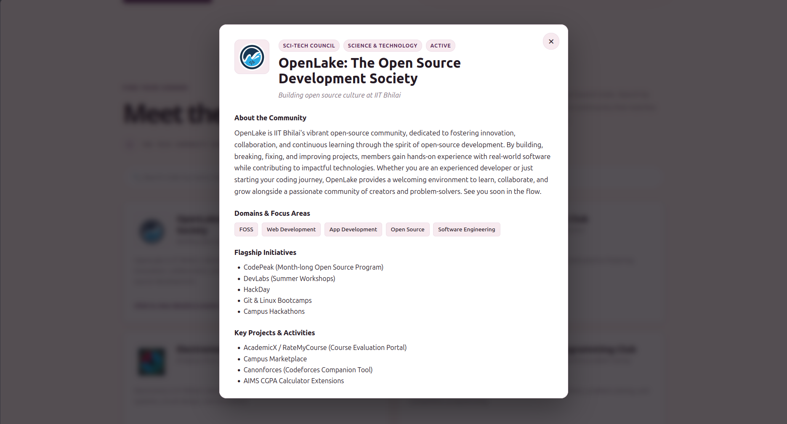
  - ## 6.2 Passcode Authenticated Announcement Posting System
    - Passcode verification ensures that only authorized coordinators and core team members can broadcast institute-wide announcements.
    - 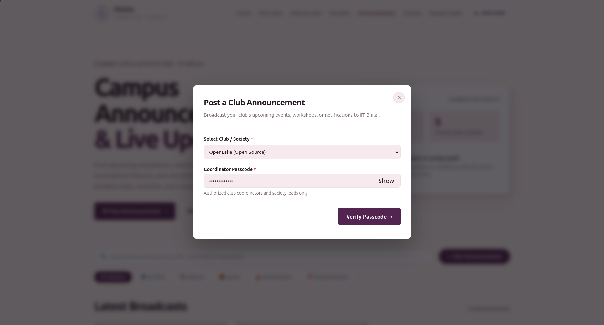
  - ## 6.3 Required Role Attribution
    - Every announcement clearly states who posted it (e.g. `Aryan Sharma (Coordinator)` or `Rohit (Core)`), preventing anonymity and confusion.
    - 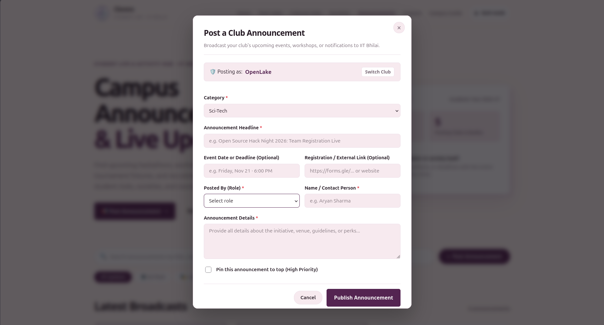
  - ## 6.4 Real-Time Search & Category Filtering
    - Users can instantly find announcements by typing any keyword or filtering by council category.
    - 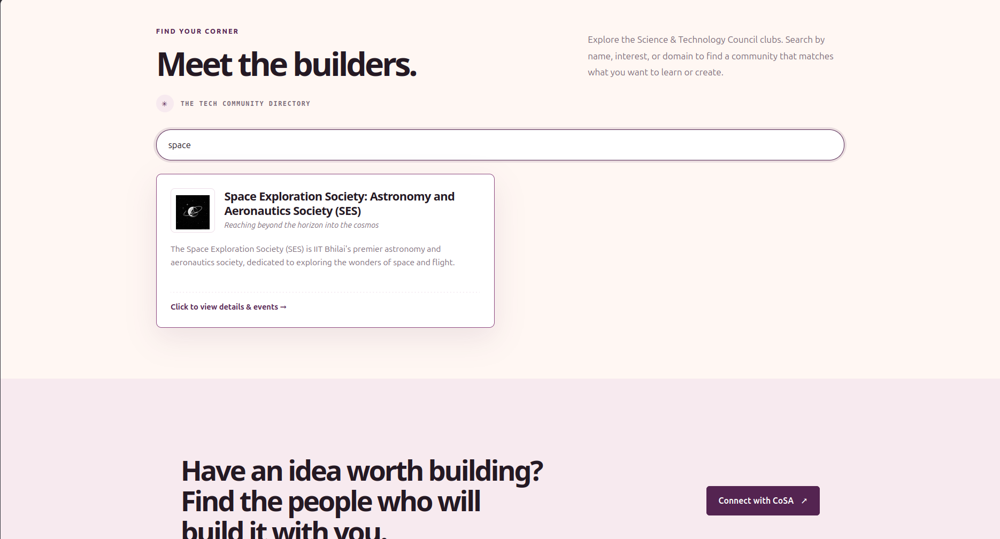
  - ## 6.5 Direct Feedback Mailing System
    - Users can directly contact developers via mail and suggest changes in the website.
    - 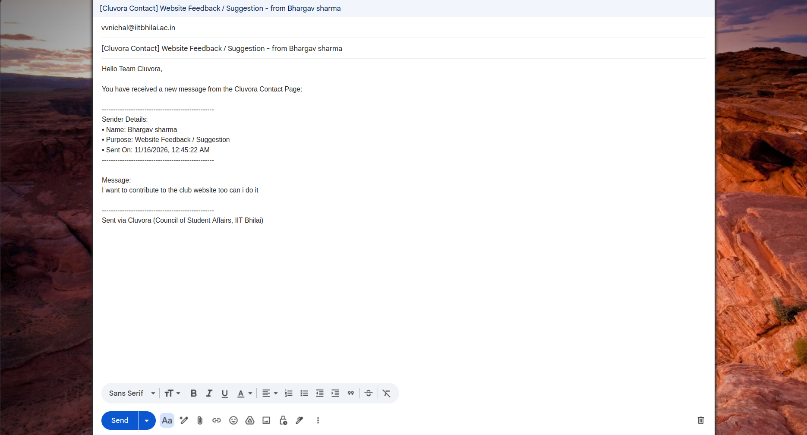
  - ## 6.6 Interactive Campus Map
    - On the Contact page, students can click numbered shortcuts to immediately view key IIT Bhilai locations on the map.
    - 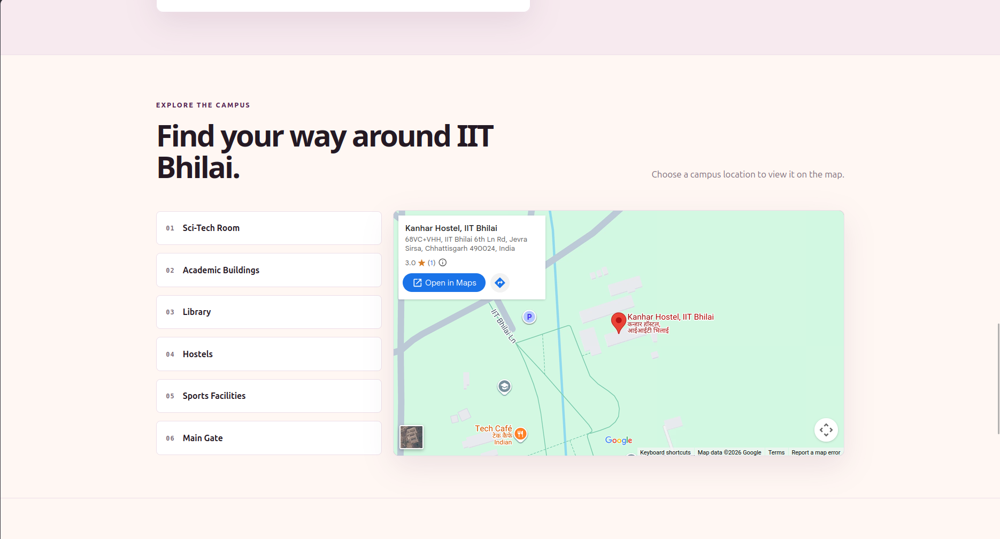
  - ## 6.7 Domain-Specific RAG AI Chatbot
    - Uses RAG to answer institute-specific questions accurately without general AI hallucinations.
    - 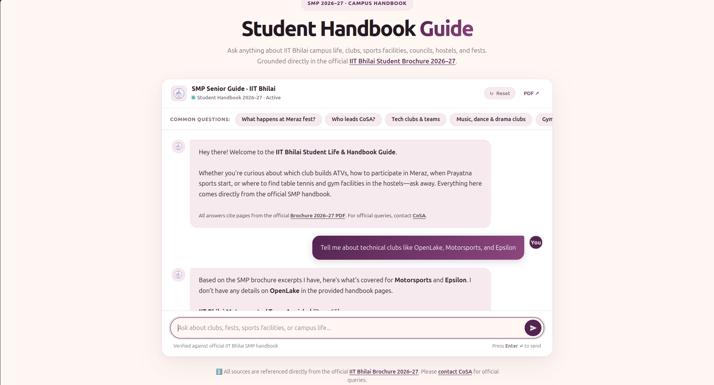
  - ## 6.8 Dark and Light Theme
    - Built-in theme switcher that respects user preferences and works seamlessly on all pages.
    - 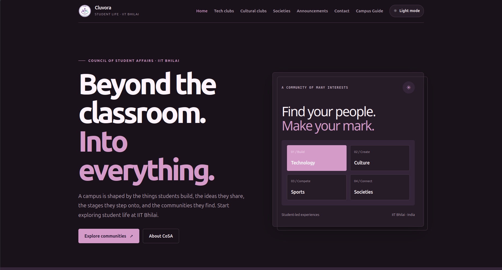
  - ## 6.9 Accurate Web-scrapped Data
    - Data used in the website is accurate and up-to-date according to the brochures and official IIT Bhilai websites and docs.
  - ## 6.10 Optimized And Efficient Database
    - Sqlite3 is used to make the announcements and clubs database efficient and fast.
- # 7. Pages & Visual Outputs
  - ## 7.1 Home Page (`/`)
    - Welcoming hero section with institute crest, quick links, and introductory cards for technical clubs, cultural clubs, societies, and broadcasts.
    - 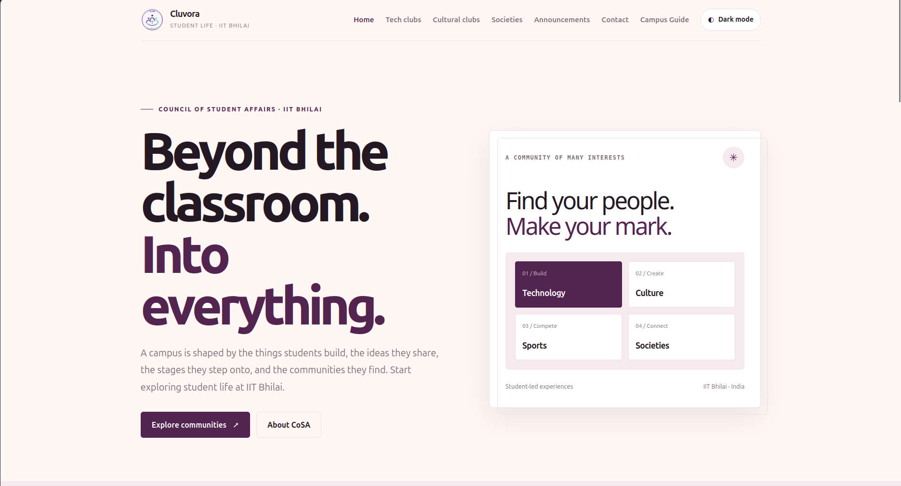
  - ## 7.2 Tech Clubs Page (`/tech-clubs`)
    - Shows all Sci-Tech Council bodies: OpenLake, Spectre, DSAI, Electromos, Ingenuity, Epsilon, SES, Motorsports, etc.
    - Each card displays logo, domain, tagline, and is clickable for full details.
    - 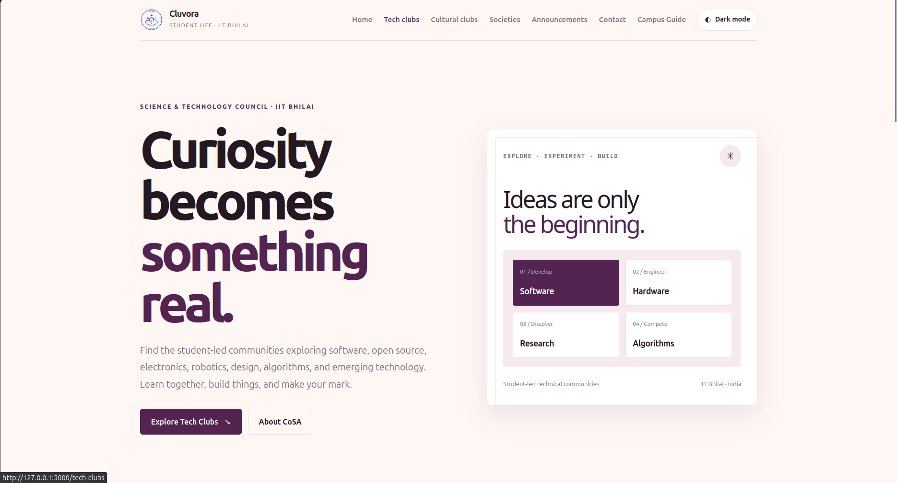
  - ## 7.3 Cultural Clubs Page (`/cultural-clubs`)
    - Covers Beat Hackers, Swara, Drishya, Quizzotica, Renaissance, SPIC MACAY, Inside Club, FPS, Pixel Snappers, etc.
    - 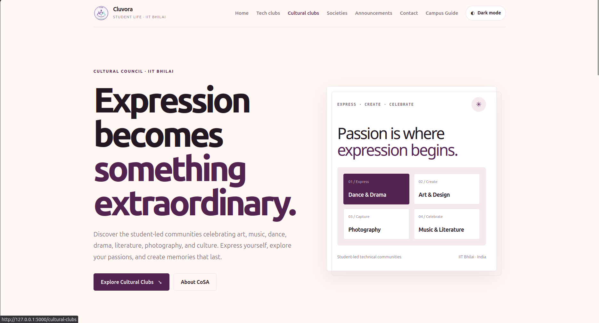
  - ## 7.4 Societies Page (`/societies`)
    - Covers institute-level bodies: Council of Student Affairs (CoSA), Sports Council, etc.
    - 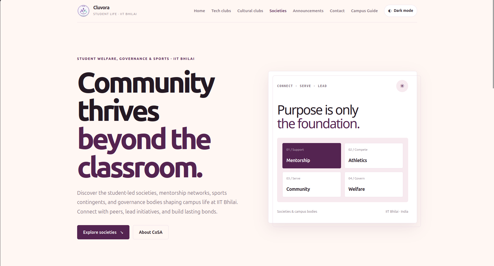
  - ## 7.5 Announcements Page (`/announcements`)
    - Live feed with search bar, category pills, stats counter, and the "Post Announcement" button opening the 2-step coordinator verification modal.
    - 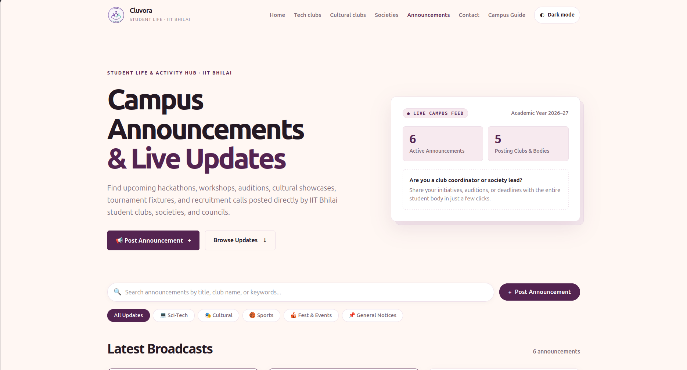
  - ## 7.6 Campus Guide Chatbot (`/chatbot`)
    - Interactive chat interface for campus Q&A.
    - 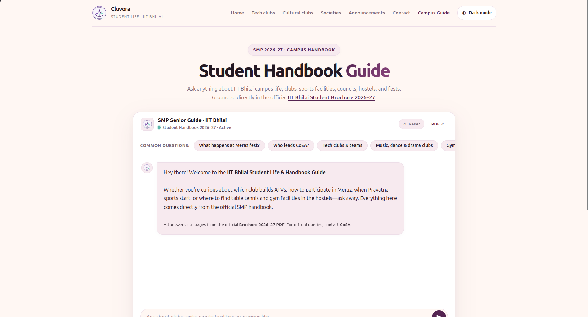
  - ## 7.7 Contact Page (`/contact`)
    - CoSA contact details, official links, and the interactive campus places map.
    - 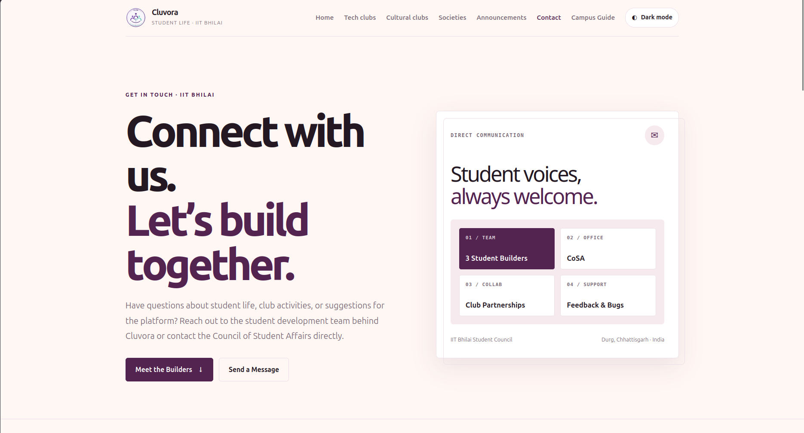

- # 8. Team Collaboration & GitHub Usage
  - ## 8.1 Repository practices
    - We maintained the project in a GitHub repository using regular commits and feature branches.
    - Merged features using pull requests (e.g., interactive cards, map additions, authentication modules).
    - Kept code clean and modular across all the files.

- # 9. How to Run the Project
  - ## 9.1 Requirements
    - Python 3.10 or higher and `pip`.
  - ## 9.2 Running locally
    - Clone the repository:
      ```bash
      git clone https://github.com/vedantnichal/Cluvora.git
      cd Cluvora
      ```
    - Set up a virtual environment:
      - For Linux Destros and Mac OS
        ```bash
        python3 -m venv .venv
        source .venv/bin/activate
        ```
      - For Windows
        ```powershell
        python -m venv .venv
        .venv\Scripts\activate
        ```
    - Install requirements:
      ```bash
      pip install -r requirements.txt
      ```
    - Set up `.env` with your OpenRouter key (optional for chatbot):
      ```bash
      cp .env.example .env
      ```
    - Run the application:
      ```bash
      python3 main.py
      ```
    - Open `http://localhost:5000` in any web browser.

  - ## 9.3 Default Test Credentials for Coordinators
    - `OpenLake`: `openlake@2026`
    - `Spectre`: `spectre@2026`
    - `Beat Hackers`: `beathackers@2026`
    - `Sports Council`: `sports@2026`
